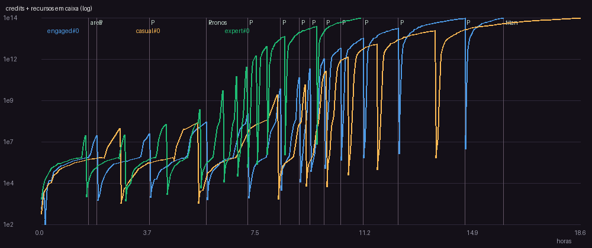
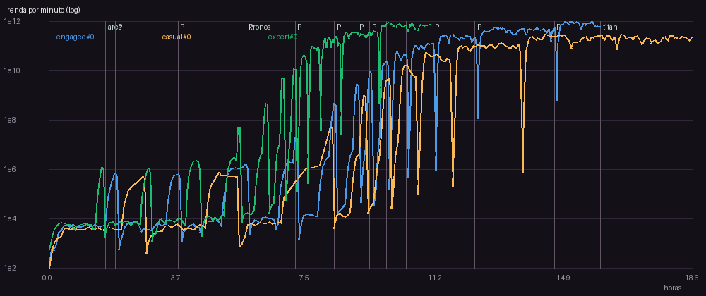
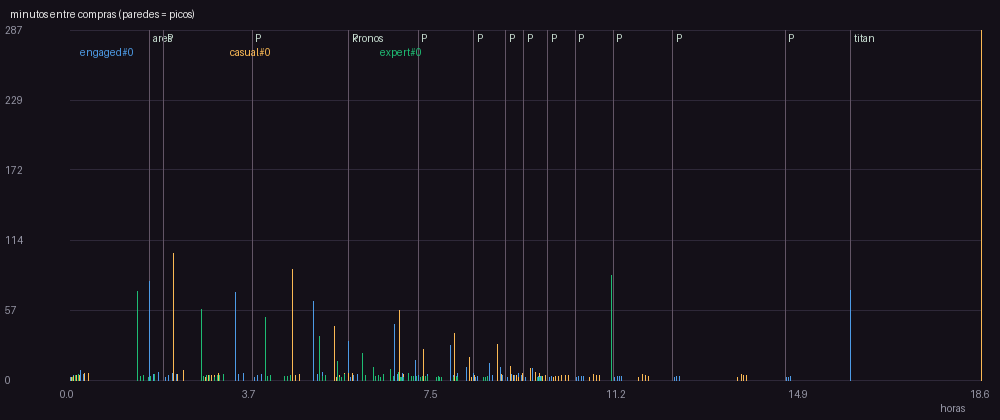
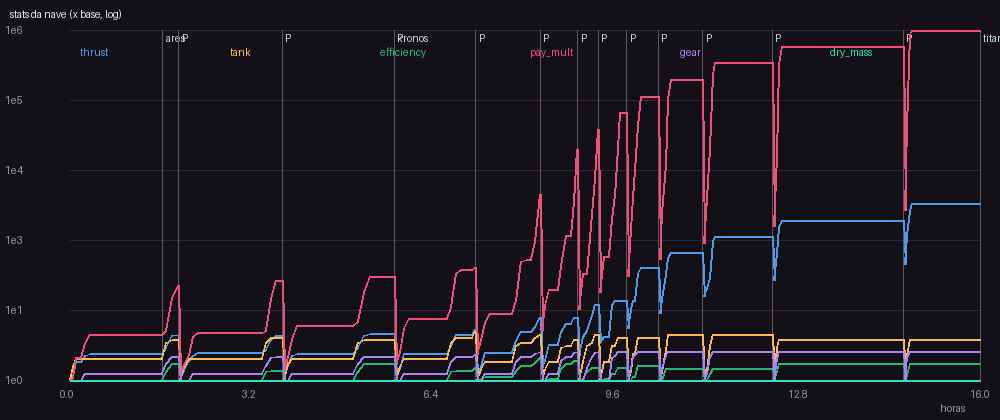

# v3 - habilidade x prestigio

Versao da spec: 3

## Perfil engaged (seed 0)

- Horas simuladas: 15.99 | runs: 260 | objetivo final: 15.99h
- Primeira compra: 145s | intervalo mediano: 3.72 min | p90: 13.55 min
- Run mediano: 185.0s, 3.0 entregas, batidas 3.5%
- Planetas: {'ares': 1.66, 'kronos': 5.73, 'titan': 15.99}
- Prestigios: [{'at_h': 1.95, 'gain': 11, 'points': 11.0}, {'at_h': 3.76, 'gain': 12, 'points': 23.0}, {'at_h': 5.73, 'gain': 25, 'points': 48.0}, {'at_h': 7.15, 'gain': 50, 'points': 98.0}, {'at_h': 8.28, 'gain': 264, 'points': 362.0}, {'at_h': 8.94, 'gain': 574, 'points': 936.0}] ...
- Niveis comprados por upgrade (%): {'contracts': 36.1, 'thrust': 30.3, 'gear': 13.3, 'tank': 11.2, 'efficiency': 7.4, 'refinery': 1.8}
- Gasto por upgrade (%): {'contracts': 96.0, 'efficiency': 1.6, 'refinery': 1.4, 'thrust': 1.0, 'tank': 0.1, 'gear': 0.0}
- Maior numero: 112T -> float64 ok
- **Avisos:**
  - 15 paredes (intervalo acima do limite da fase); pior: 129.9 min antes de 'prestige' em 14.65h (limite 20 min)
  - primeiro prestigio em 1.95h (alvo 2-6h)

## Perfil casual (seed 0)

- Horas simuladas: 18.63 | runs: 257 | objetivo final: 18.63h
- Primeira compra: 107s | intervalo mediano: 3.94 min | p90: 28.84 min
- Run mediano: 213.2s, 3 entregas, batidas 5.8%
- Planetas: {'ares': 2.12, 'kronos': 5.43, 'titan': 18.63}
- Prestigios: [{'at_h': 2.73, 'gain': 16, 'points': 16.0}, {'at_h': 5.43, 'gain': 24, 'points': 40.0}, {'at_h': 8.18, 'gain': 166, 'points': 206.0}, {'at_h': 9.14, 'gain': 351, 'points': 557.0}, {'at_h': 9.85, 'gain': 863, 'points': 1420.0}, {'at_h': 10.6, 'gain': 2241, 'points': 3661.0}] ...
- Niveis comprados por upgrade (%): {'contracts': 34.9, 'thrust': 26.6, 'tank': 13.8, 'gear': 13.1, 'efficiency': 9.3, 'refinery': 2.3}
- Gasto por upgrade (%): {'contracts': 95.2, 'efficiency': 2.1, 'refinery': 1.9, 'thrust': 0.7, 'tank': 0.1, 'gear': 0.0}
- Maior numero: 110T -> float64 ok
- **Avisos:**
  - 16 paredes (intervalo acima do limite da fase); pior: 287.3 min antes de 'titan' em 18.63h (limite 45 min)

## Perfil expert (seed 0)

- Horas simuladas: 11.06 | runs: 209 | objetivo final: 11.06h
- Primeira compra: 139s | intervalo mediano: 3.04 min | p90: 9.87 min
- Run mediano: 168.0s, 3 entregas, batidas 1.0%
- Planetas: {'ares': 1.38, 'kronos': 5.46, 'titan': 11.06}
- Prestigios: [{'at_h': 1.55, 'gain': 11, 'points': 11.0}, {'at_h': 2.9, 'gain': 11, 'points': 22.0}, {'at_h': 4.34, 'gain': 22, 'points': 44.0}, {'at_h': 5.49, 'gain': 63, 'points': 107.0}, {'at_h': 6.29, 'gain': 225, 'points': 332.0}, {'at_h': 6.77, 'gain': 616, 'points': 948.0}] ...
- Niveis comprados por upgrade (%): {'contracts': 38.6, 'thrust': 28.3, 'gear': 13.6, 'tank': 10.8, 'efficiency': 6.9, 'refinery': 1.8}
- Gasto por upgrade (%): {'contracts': 96.0, 'efficiency': 1.7, 'refinery': 1.6, 'thrust': 0.6, 'tank': 0.1, 'gear': 0.0}
- Maior numero: 112T -> float64 ok
- **Avisos:**
  - 11 paredes (intervalo acima do limite da fase); pior: 86.0 min antes de 'titan' em 11.06h (limite 20 min)
  - primeiro prestigio em 1.55h (alvo 2-6h)

## Curvas dos upgrades

### Motor (velocidade)

| nivel | custo credits | thrust |
|---|---|---|
| 0 | 40 | 4 |
| 5 | 87 | 7 |
| 10 | 192 | 10 |
| 15 | 421 | 13 |
| 20 | 924 | 16 |
| 25 | 2.03K | 19 |
| 30 | 4.44K | 22 |

### Tanque de gas

| nivel | custo credits | tank |
|---|---|---|
| 0 | 30 | 100 |
| 5 | 63 | 176 |
| 10 | 132 | 311 |
| 15 | 277 | 547 |
| 20 | 583 | 965 |
| 25 | 1.23K | 1.7e+03 |
| 30 | 2.58K | 3e+03 |

### Bocais (eficiencia)

| nivel | custo credits | efficiency |
|---|---|---|
| 0 | 60 | 3 |
| 5 | 149 | 4.21 |
| 10 | 371 | 5.9 |
| 15 | 924 | 8.28 |
| 20 | 2.30K | 11.6 |
| 25 | 5.72K | 16.3 |
| 30 | 14.2K | 22.8 |

### Reputacao (pagamento)

| nivel | custo credits | pay_mult |
|---|---|---|
| 0 | 120 | 1 |
| 5 | 324 | 1.61 |
| 10 | 876 | 2.59 |
| 15 | 2.37K | 4.18 |
| 20 | 6.40K | 6.73 |
| 25 | 17.3K | 10.8 |
| 30 | 46.8K | 17.4 |

### Trem de pouso

| nivel | custo credits | gear |
|---|---|---|
| 0 | 80 | 1 |
| 5 | 244 | 2.15 |
| 10 | 745 | 2.67 |
| 15 | 2.27K | 2.96 |
| 20 | 6.94K | 3.14 |
| 25 | 21.2K | 3.27 |
| 30 | 64.6K | 3.37 |

### Refinaria (eficiencia com minerio)

| nivel | custo credits | custo ore | efficiency |
|---|---|---|---|
| 0 | 4.00K | 15 | 3 |
| 5 | 14.9K | 55 | 6.03 |
| 10 | 55.1K | 206 | 12.1 |
| 15 | 205K | 767 | 24.4 |
| 20 | 760K | 2.85K | 49.1 |
| 25 | 2.82M | 10.6K | 98.8 |
| 30 | 10.5M | 39.3K | 199 |
