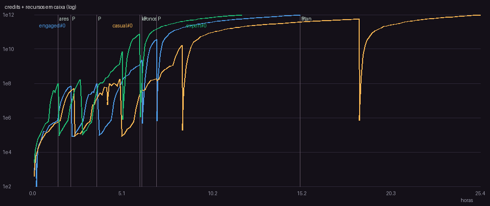
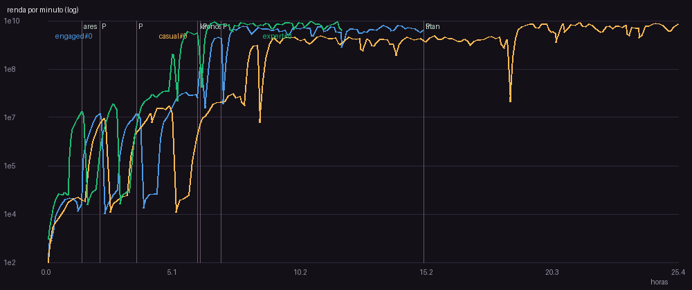
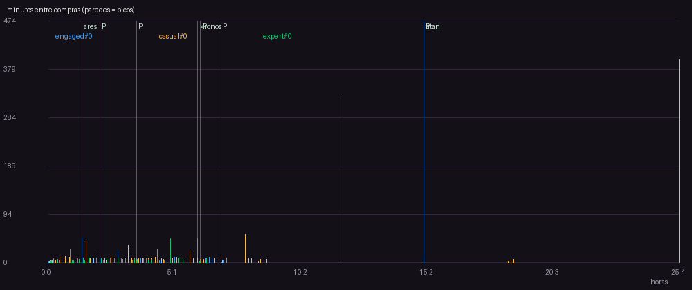
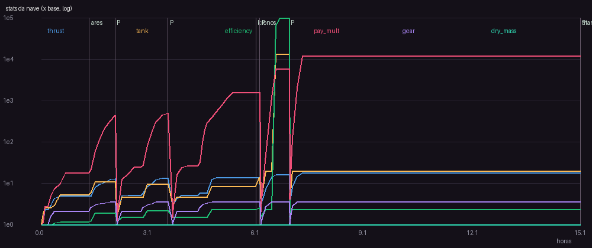

# v4 - loja de prestigio

Versao da spec: 4

## Perfil engaged (seed 0)

- Horas simuladas: 15.11 | runs: 128 | objetivo final: 15.11h
- Primeira compra: 145s | intervalo mediano: 7.5 min | p90: 10.02 min
- Run mediano: 447.2s, 6.0 entregas, batidas 7.0%
- Planetas: {'ares': 1.37, 'kronos': 6.04, 'titan': 15.11}
- Prestigios: [{'at_h': 2.1, 'gain': 22, 'points': 22.0}, {'at_h': 3.58, 'gain': 22, 'points': 44.0}, {'at_h': 6.15, 'gain': 50, 'points': 94.0}, {'at_h': 6.97, 'gain': 95, 'points': 189.0}, {'at_h': 15.11, 'gain': 223, 'points': 412.0}]
- Niveis comprados por upgrade (%): {'contracts': 27.9, 'thrust': 26.8, 'tank': 14.6, 'efficiency': 13.2, 'gear': 11.3, 'refinery': 6.2}
- Gasto por upgrade (%): {'contracts': 81.5, 'efficiency': 8.7, 'refinery': 7.9, 'thrust': 1.5, 'tank': 0.4, 'gear': 0.0}
- Maior numero: 2.00T -> float64 ok
- **Avisos:**
  - 11 paredes (intervalo acima do limite da fase); pior: 474.5 min antes de 'titan' em 15.11h (limite 45 min)
  - run mediano de 447.2s (alvo 45-240s)

## Perfil casual (seed 0)

- Horas simuladas: 25.35 | runs: 200 | objetivo final: 25.35h
- Primeira compra: 107s | intervalo mediano: 8.15 min | p90: 12.03 min
- Run mediano: 465.5s, 6.0 entregas, batidas 9.5%
- Planetas: {'ares': 1.53, 'kronos': 7.91, 'titan': 25.35}
- Prestigios: [{'at_h': 2.27, 'gain': 20, 'points': 20.0}, {'at_h': 4.88, 'gain': 30, 'points': 50.0}, {'at_h': 8.41, 'gain': 79, 'points': 129.0}, {'at_h': 18.48, 'gain': 194, 'points': 323.0}]
- Niveis comprados por upgrade (%): {'contracts': 28.0, 'thrust': 26.4, 'tank': 14.8, 'efficiency': 13.4, 'gear': 11.3, 'refinery': 6.0}
- Gasto por upgrade (%): {'contracts': 83.5, 'efficiency': 7.7, 'refinery': 7.1, 'thrust': 1.4, 'tank': 0.3, 'gear': 0.0}
- Maior numero: 2.04T -> float64 ok
- **Avisos:**
  - 15 paredes (intervalo acima do limite da fase); pior: 581.6 min antes de 'prestige' em 18.48h (limite 45 min)
  - planeta 'titan' desbloqueado em 25.35h (alvo 10-25h)
  - run mediano de 465.5s (alvo 45-240s)

## Perfil expert (seed 0)

- Horas simuladas: 11.82 | runs: 109 | objetivo final: 11.82h
- Primeira compra: 139s | intervalo mediano: 6.84 min | p90: 22.39 min
- Run mediano: 399.8s, 6 entregas, batidas 3.7%
- Planetas: {'ares': 0.84, 'kronos': 4.88, 'titan': 11.82}
- Prestigios: [{'at_h': 1.37, 'gain': 22, 'points': 22.0}, {'at_h': 2.62, 'gain': 25, 'points': 47.0}, {'at_h': 5.02, 'gain': 63, 'points': 110.0}, {'at_h': 6.01, 'gain': 113, 'points': 223.0}, {'at_h': 11.82, 'gain': 224, 'points': 447.0}]
- Niveis comprados por upgrade (%): {'contracts': 25.2, 'thrust': 23.9, 'tank': 16.7, 'efficiency': 16.3, 'gear': 9.7, 'refinery': 8.3}
- Gasto por upgrade (%): {'contracts': 77.3, 'efficiency': 11.0, 'refinery': 10.0, 'thrust': 1.3, 'tank': 0.5, 'gear': 0.0}
- Maior numero: 2.03T -> float64 ok
- **Avisos:**
  - 12 paredes (intervalo acima do limite da fase); pior: 328.9 min antes de 'titan' em 11.82h (limite 20 min)
  - primeiro prestigio em 1.37h (alvo 2-6h)
  - run mediano de 399.8s (alvo 45-240s)

## Curvas dos upgrades

### Motor (velocidade)

| nivel | custo credits | thrust |
|---|---|---|
| 0 | 40 | 4 |
| 5 | 87 | 7 |
| 10 | 192 | 10 |
| 15 | 421 | 13 |
| 20 | 924 | 16 |
| 25 | 2.03K | 19 |
| 30 | 4.44K | 22 |

### Tanque de gas

| nivel | custo credits | tank |
|---|---|---|
| 0 | 30 | 100 |
| 5 | 63 | 176 |
| 10 | 132 | 311 |
| 15 | 277 | 547 |
| 20 | 583 | 965 |
| 25 | 1.23K | 1.7e+03 |
| 30 | 2.58K | 3e+03 |

### Bocais (eficiencia)

| nivel | custo credits | efficiency |
|---|---|---|
| 0 | 60 | 3 |
| 5 | 149 | 4.21 |
| 10 | 371 | 5.9 |
| 15 | 924 | 8.28 |
| 20 | 2.30K | 11.6 |
| 25 | 5.72K | 16.3 |
| 30 | 14.2K | 22.8 |

### Reputacao (pagamento)

| nivel | custo credits | pay_mult |
|---|---|---|
| 0 | 120 | 1 |
| 5 | 324 | 1.61 |
| 10 | 876 | 2.59 |
| 15 | 2.37K | 4.18 |
| 20 | 6.40K | 6.73 |
| 25 | 17.3K | 10.8 |
| 30 | 46.8K | 17.4 |

### Trem de pouso

| nivel | custo credits | gear |
|---|---|---|
| 0 | 80 | 1 |
| 5 | 244 | 2.15 |
| 10 | 745 | 2.67 |
| 15 | 2.27K | 2.96 |
| 20 | 6.94K | 3.14 |
| 25 | 21.2K | 3.27 |
| 30 | 64.6K | 3.37 |

### Refinaria (eficiencia com minerio)

| nivel | custo credits | custo ore | efficiency |
|---|---|---|---|
| 0 | 4.00K | 15 | 3 |
| 5 | 14.9K | 55 | 6.03 |
| 10 | 55.1K | 206 | 12.1 |
| 15 | 205K | 767 | 24.4 |
| 20 | 760K | 2.85K | 49.1 |
| 25 | 2.82M | 10.6K | 98.8 |
| 30 | 10.5M | 39.3K | 199 |
