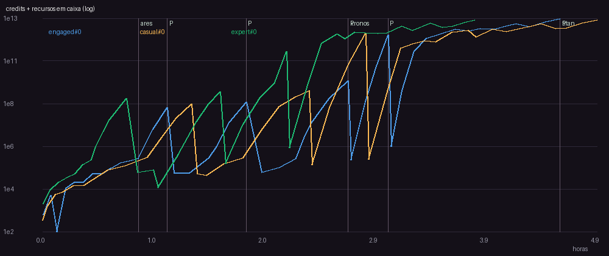
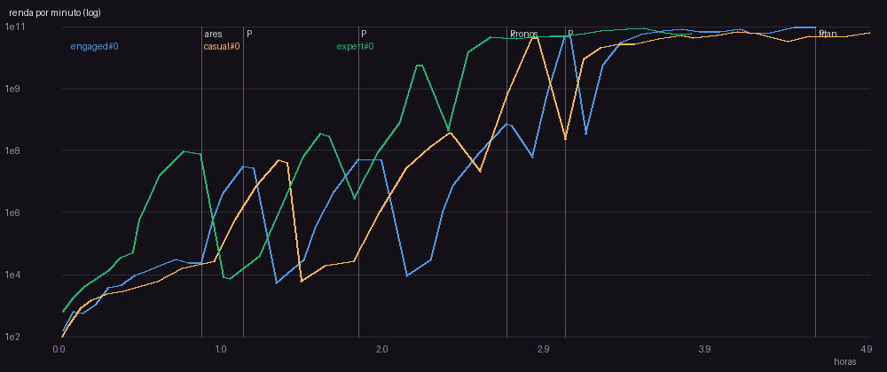
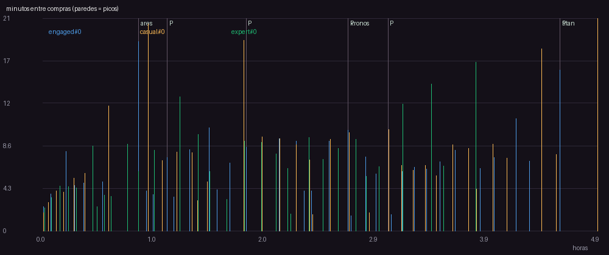
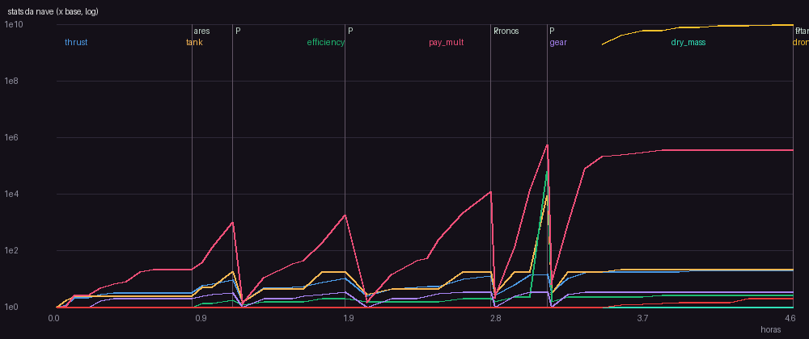

# v6 - frota + marcos + Expedicao a Titan

Versao da spec: 6

## Perfil engaged (seed 0)

- Horas simuladas: 4.57 | runs: 46 | objetivo final: 4.57h
- Primeira compra: 145s | intervalo mediano: 6.82 min | p90: 10.18 min
- Run mediano: 364.8s, 6.0 entregas, batidas 2.2%
- Planetas: {'ares': 0.87, 'kronos': 2.71, 'titan': 4.57}
- Prestigios: [{'at_h': 1.12, 'gain': 22, 'points': 22.0}, {'at_h': 1.81, 'gain': 26, 'points': 48.0}, {'at_h': 2.71, 'gain': 51, 'points': 99.0}, {'at_h': 3.06, 'gain': 205, 'points': 304.0}, {'at_h': 4.57, 'gain': 425, 'points': 729.0}]
- Niveis comprados por upgrade (%): {'contracts': 31.2, 'thrust': 29.9, 'tank': 12.6, 'gear': 12.5, 'efficiency': 8.3, 'refinery': 3.5, 'fleet': 0.8, 'autopilot': 0.6, 'exp1_station': 0.1, 'exp2_cryo': 0.1, 'exp3_shield': 0.1, 'exp4_satnet': 0.1, 'exp5_habitat': 0.1, 'exp6_fusion': 0.1, 'exp7_anchor': 0.1, 'exp8_aurora': 0.1}
- Gasto por upgrade (%): {'exp8_aurora': 32.2, 'exp7_anchor': 18.9, 'fleet': 14.1, 'exp6_fusion': 11.1, 'autopilot': 8.9, 'exp5_habitat': 6.5, 'exp4_satnet': 3.9, 'exp3_shield': 2.3, 'exp2_cryo': 1.3, 'exp1_station': 0.8, 'contracts': 0.1, 'efficiency': 0.0, 'refinery': 0.0, 'thrust': 0.0, 'tank': 0.0, 'gear': 0.0}
- Maior numero: 10.4T -> float64 ok
- **Avisos:**
  - 2 paredes (intervalo acima do limite da fase); pior: 19.1 min antes de 'ares' em 0.87h (limite 5 min)
  - run mediano de 364.8s (alvo 45-240s)

## Perfil casual (seed 0)

- Horas simuladas: 4.89 | runs: 42 | objetivo final: 4.89h
- Primeira compra: 107s | intervalo mediano: 7.33 min | p90: 12.61 min
- Run mediano: 434.1s, 6.0 entregas, batidas 7.1%
- Planetas: {'ares': 0.95, 'kronos': 2.37, 'titan': 4.89}
- Prestigios: [{'at_h': 1.34, 'gain': 25, 'points': 25.0}, {'at_h': 2.37, 'gain': 41, 'points': 66.0}, {'at_h': 2.86, 'gain': 217, 'points': 283.0}]
- Niveis comprados por upgrade (%): {'contracts': 29.8, 'thrust': 28.3, 'tank': 13.3, 'gear': 12.0, 'efficiency': 10.4, 'refinery': 4.0, 'fleet': 1.0, 'autopilot': 0.5, 'exp1_station': 0.1, 'exp2_cryo': 0.1, 'exp3_shield': 0.1, 'exp4_satnet': 0.1, 'exp5_habitat': 0.1, 'exp6_fusion': 0.1, 'exp7_anchor': 0.1, 'exp8_aurora': 0.1}
- Gasto por upgrade (%): {'exp8_aurora': 34.2, 'exp7_anchor': 20.1, 'fleet': 15.0, 'exp6_fusion': 11.8, 'exp5_habitat': 7.0, 'exp4_satnet': 4.1, 'autopilot': 3.1, 'exp3_shield': 2.4, 'exp2_cryo': 1.4, 'exp1_station': 0.8, 'contracts': 0.0, 'efficiency': 0.0, 'refinery': 0.0, 'thrust': 0.0, 'tank': 0.0, 'gear': 0.0}
- Maior numero: 8.34T -> float64 ok
- **Avisos:**
  - 4 paredes (intervalo acima do limite da fase); pior: 20.9 min antes de 'ares' em 0.95h (limite 5 min)
  - 3 prestigios ate o fim (alvo 4-6)
  - run mediano de 434.1s (alvo 45-240s)

## Perfil expert (seed 0)

- Horas simuladas: 3.82 | runs: 39 | objetivo final: 3.82h
- Primeira compra: 139s | intervalo mediano: 6.54 min | p90: 12.79 min
- Run mediano: 345.1s, 6 entregas, batidas 5.1%
- Planetas: {'ares': 0.46, 'kronos': 2.07, 'titan': 3.82}
- Prestigios: [{'at_h': 0.76, 'gain': 29, 'points': 29.0}, {'at_h': 1.58, 'gain': 38, 'points': 67.0}, {'at_h': 2.17, 'gain': 124, 'points': 191.0}, {'at_h': 3.82, 'gain': 416, 'points': 607.0}]
- Niveis comprados por upgrade (%): {'contracts': 30.3, 'thrust': 29.3, 'tank': 13.4, 'gear': 11.5, 'efficiency': 9.0, 'refinery': 4.2, 'fleet': 1.0, 'autopilot': 0.5, 'exp1_station': 0.1, 'exp2_cryo': 0.1, 'exp3_shield': 0.1, 'exp4_satnet': 0.1, 'exp5_habitat': 0.1, 'exp6_fusion': 0.1, 'exp7_anchor': 0.1, 'exp8_aurora': 0.1}
- Gasto por upgrade (%): {'exp8_aurora': 34.2, 'exp7_anchor': 20.1, 'fleet': 15.0, 'exp6_fusion': 11.8, 'exp5_habitat': 7.0, 'exp4_satnet': 4.1, 'autopilot': 3.1, 'exp3_shield': 2.4, 'exp2_cryo': 1.4, 'exp1_station': 0.8, 'contracts': 0.0, 'efficiency': 0.0, 'refinery': 0.0, 'thrust': 0.0, 'tank': 0.0, 'gear': 0.0}
- Maior numero: 8.26T -> float64 ok
- **Avisos:**
  - 4 paredes (intervalo acima do limite da fase); pior: 8.7 min antes de 'thrust' em 0.76h (limite 5 min)
  - run mediano de 345.1s (alvo 45-240s)

## Curvas dos upgrades

### Motor (velocidade)

| nivel | custo credits | thrust |
|---|---|---|
| 0 | 40 | 4 |
| 5 | 87 | 7 |
| 10 | 192 | 10 |
| 15 | 421 | 13 |
| 20 | 924 | 16 |
| 25 | 2.03K | 19 |
| 30 | 4.44K | 22 |

### Tanque de gas

| nivel | custo credits | tank |
|---|---|---|
| 0 | 30 | 100 |
| 5 | 63 | 176 |
| 10 | 132 | 311 |
| 15 | 277 | 547 |
| 20 | 583 | 965 |
| 25 | 1.23K | 1.7e+03 |
| 30 | 2.58K | 3e+03 |

### Bocais (eficiencia)

| nivel | custo credits | efficiency |
|---|---|---|
| 0 | 60 | 3 |
| 5 | 149 | 4.21 |
| 10 | 371 | 5.9 |
| 15 | 924 | 8.28 |
| 20 | 2.30K | 11.6 |
| 25 | 5.72K | 16.3 |
| 30 | 14.2K | 22.8 |

### Reputacao (pagamento)

| nivel | custo credits | pay_mult |
|---|---|---|
| 0 | 120 | 1 |
| 5 | 324 | 1.61 |
| 10 | 876 | 2.59 |
| 15 | 2.37K | 4.18 |
| 20 | 6.40K | 6.73 |
| 25 | 17.3K | 16.3 |
| 30 | 46.8K | 26.2 |

### Trem de pouso

| nivel | custo credits | gear |
|---|---|---|
| 0 | 80 | 1 |
| 5 | 244 | 2.15 |
| 10 | 745 | 2.67 |
| 15 | 2.27K | 2.96 |
| 20 | 6.94K | 3.14 |
| 25 | 21.2K | 3.27 |
| 30 | 64.6K | 3.37 |

### Refinaria (eficiencia com minerio)

| nivel | custo credits | custo ore | efficiency |
|---|---|---|---|
| 0 | 4.00K | 15 | 3 |
| 5 | 14.9K | 55 | 6.03 |
| 10 | 55.1K | 206 | 12.1 |
| 15 | 205K | 767 | 24.4 |
| 20 | 760K | 2.85K | 49.1 |
| 25 | 2.82M | 10.6K | 98.8 |
| 30 | 10.5M | 39.3K | 199 |

### Frota de drones

| nivel | custo credits | drones |
|---|---|---|
| 0 | 20.0B | 0 |
| 5 | 210B | 5 |
| 10 | 2.20T | 10 |

### Software de piloto automatico

| nivel | custo credits | autopilot |
|---|---|---|
| 0 | 40.0B | 0.08 |
| 5 | 568B | 0.121 |
| 10 | 8.06T | 0.136 |
| 15 | 114T | 0.144 |

### Expedicao Titan 1/8: Estacao Orbital de Apoio

| nivel | custo credits | custo ore | pay_mult |
|---|---|---|---|
| 0 | 200B | 33.3M | 1 |

### Expedicao Titan 2/8: Tanques Criogenicos

| nivel | custo credits | custo ore | tank |
|---|---|---|---|
| 0 | 340B | 56.7M | 100 |

### Expedicao Titan 3/8: Escudo Termico Ablativo

| nivel | custo credits | custo ore | pay_mult |
|---|---|---|---|
| 0 | 578B | 96.3M | 1 |

### Expedicao Titan 4/8: Rede de Satelites de Navegacao

| nivel | custo credits | custo ore | efficiency |
|---|---|---|---|
| 0 | 983B | 164M | 3 |

### Expedicao Titan 5/8: Modulo de Habitacao

| nivel | custo credits | custo ore | pay_mult |
|---|---|---|---|
| 0 | 1.67T | 278M | 1 |

### Expedicao Titan 6/8: Reator de Fusao Compacto

| nivel | custo credits | custo ore | thrust |
|---|---|---|---|
| 0 | 2.84T | 473M | 4 |

### Expedicao Titan 7/8: Ancora Gravitacional

| nivel | custo credits | custo ore | autopilot |
|---|---|---|---|
| 0 | 4.83T | 805M | 0.08 |

### Expedicao Titan 8/8: Nave-mae Aurora

| nivel | custo credits | custo ore | pay_mult |
|---|---|---|---|
| 0 | 8.21T | 1.37B | 1 |
