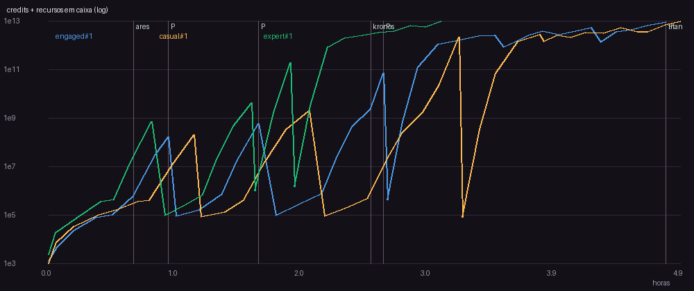
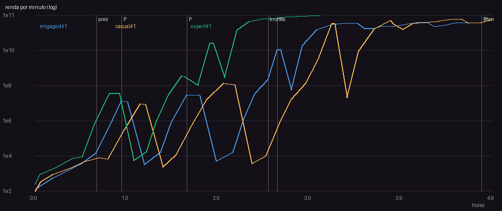
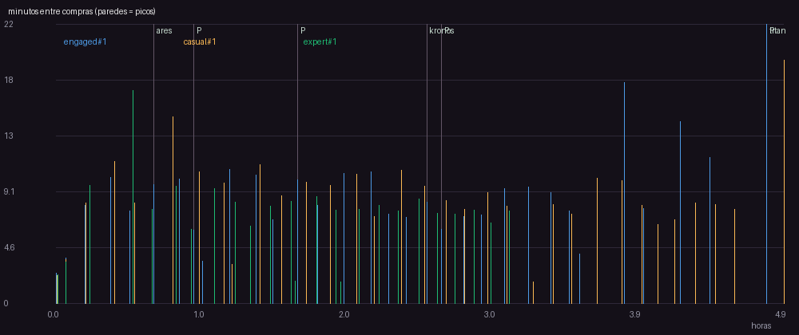
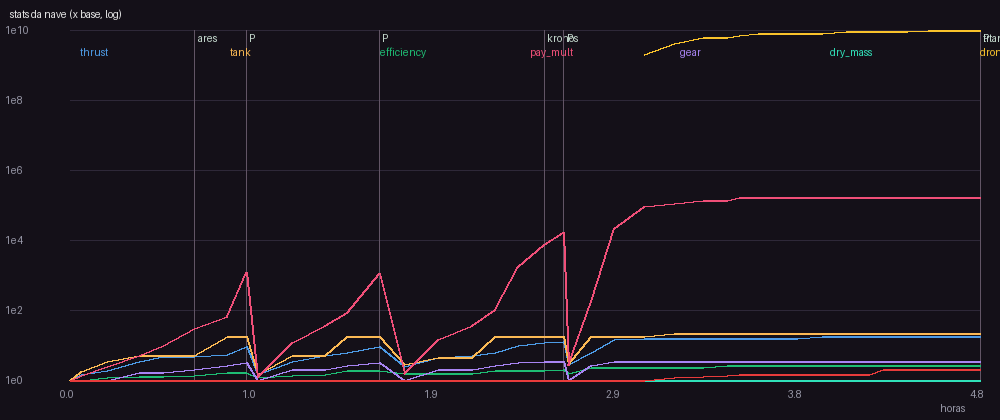

# Relatorio de balanceamento

Versao da spec: 7

## Perfil engaged (seed 1)

- Horas simuladas: 4.79 | runs: 39 | objetivo final: 4.79h
- Primeira compra: 146s | intervalo mediano: 7.95 min | p90: 10.92 min
- Run mediano: 451.3s, 6 entregas, batidas 5.1%
- Planetas: {'ares': 0.69, 'kronos': 2.52, 'titan': 4.79}
- Prestigios: [{'at_h': 0.96, 'gain': 21, 'points': 21.0}, {'at_h': 1.66, 'gain': 28, 'points': 49.0}, {'at_h': 2.62, 'gain': 94, 'points': 143.0}, {'at_h': 4.79, 'gain': 418, 'points': 561.0}]
- Niveis comprados por upgrade (%): {'contracts': 29.6, 'thrust': 28.4, 'tank': 13.6, 'gear': 12.2, 'efficiency': 9.6, 'refinery': 4.1, 'fleet': 1.0, 'autopilot': 0.6, 'exp1_station': 0.1, 'exp2_cryo': 0.1, 'exp3_shield': 0.1, 'exp4_satnet': 0.1, 'exp5_habitat': 0.1, 'exp6_fusion': 0.1, 'exp7_anchor': 0.1, 'exp8_aurora': 0.1}
- Gasto por upgrade (%): {'exp8_aurora': 33.4, 'exp7_anchor': 19.7, 'fleet': 14.6, 'exp6_fusion': 11.6, 'exp5_habitat': 6.8, 'autopilot': 5.3, 'exp4_satnet': 4.0, 'exp3_shield': 2.4, 'exp2_cryo': 1.4, 'exp1_station': 0.8, 'contracts': 0.0, 'efficiency': 0.0, 'refinery': 0.0, 'thrust': 0.0, 'tank': 0.0, 'gear': 0.0}
- Maior numero: 8.78T -> float64 ok
- **Avisos:**
  - 6 paredes (intervalo acima do limite da fase); pior: 10.3 min antes de 'contracts' em 0.41h (limite 5 min)
  - run mediano de 451.3s (alvo 45-240s)

## Perfil casual (seed 1)

- Horas simuladas: 4.9 | runs: 38 | objetivo final: 4.9h
- Primeira compra: 133s | intervalo mediano: 8.18 min | p90: 10.86 min
- Run mediano: 485.2s, 6.0 entregas, batidas 5.3%
- Planetas: {'ares': 0.81, 'kronos': 2.04, 'titan': 4.9}
- Prestigios: [{'at_h': 1.16, 'gain': 21, 'points': 21.0}, {'at_h': 2.04, 'gain': 39, 'points': 60.0}, {'at_h': 3.2, 'gain': 224, 'points': 284.0}]
- Niveis comprados por upgrade (%): {'contracts': 29.2, 'thrust': 28.7, 'tank': 13.5, 'gear': 12.0, 'efficiency': 10.2, 'refinery': 4.0, 'fleet': 1.0, 'autopilot': 0.6, 'exp1_station': 0.1, 'exp2_cryo': 0.1, 'exp3_shield': 0.1, 'exp4_satnet': 0.1, 'exp5_habitat': 0.1, 'exp6_fusion': 0.1, 'exp7_anchor': 0.1, 'exp8_aurora': 0.1}
- Gasto por upgrade (%): {'exp8_aurora': 33.4, 'exp7_anchor': 19.7, 'fleet': 14.6, 'exp6_fusion': 11.6, 'exp5_habitat': 6.8, 'autopilot': 5.3, 'exp4_satnet': 4.0, 'exp3_shield': 2.4, 'exp2_cryo': 1.4, 'exp1_station': 0.8, 'contracts': 0.0, 'efficiency': 0.0, 'refinery': 0.0, 'thrust': 0.0, 'tank': 0.0, 'gear': 0.0}
- Maior numero: 9.58T -> float64 ok
- **Avisos:**
  - 5 paredes (intervalo acima do limite da fase); pior: 15.2 min antes de 'ares' em 0.81h (limite 5 min)
  - 3 prestigios ate o fim (alvo 4-6)
  - run mediano de 485.2s (alvo 45-240s)

## Perfil expert (seed 1)

- Horas simuladas: 3.06 | runs: 26 | objetivo final: 3.06h
- Primeira compra: 140s | intervalo mediano: 7.61 min | p90: 9.37 min
- Run mediano: 456.0s, 6.0 entregas, batidas 0.0%
- Planetas: {'ares': 0.54, 'kronos': 1.6, 'titan': 3.06}
- Prestigios: [{'at_h': 0.83, 'gain': 29, 'points': 29.0}, {'at_h': 1.6, 'gain': 47, 'points': 76.0}, {'at_h': 1.9, 'gain': 121, 'points': 197.0}, {'at_h': 3.06, 'gain': 419, 'points': 616.0}]
- Niveis comprados por upgrade (%): {'contracts': 30.6, 'thrust': 29.2, 'tank': 13.1, 'gear': 11.7, 'efficiency': 8.9, 'refinery': 4.0, 'fleet': 1.0, 'autopilot': 0.6, 'exp1_station': 0.1, 'exp2_cryo': 0.1, 'exp3_shield': 0.1, 'exp4_satnet': 0.1, 'exp5_habitat': 0.1, 'exp6_fusion': 0.1, 'exp7_anchor': 0.1, 'exp8_aurora': 0.1}
- Gasto por upgrade (%): {'exp8_aurora': 33.4, 'exp7_anchor': 19.7, 'fleet': 14.6, 'exp6_fusion': 11.6, 'exp5_habitat': 6.8, 'autopilot': 5.3, 'exp4_satnet': 4.0, 'exp3_shield': 2.4, 'exp2_cryo': 1.4, 'exp1_station': 0.8, 'contracts': 0.0, 'efficiency': 0.0, 'refinery': 0.0, 'thrust': 0.0, 'tank': 0.0, 'gear': 0.0}
- Maior numero: 9.00T -> float64 ok
- **Avisos:**
  - 5 paredes (intervalo acima do limite da fase); pior: 17.3 min antes de 'ares' em 0.54h (limite 5 min)
  - run mediano de 456.0s (alvo 45-240s)

## Curvas dos upgrades

### Motor (velocidade)

| nivel | custo credits | thrust |
|---|---|---|
| 0 | 40 | 4 |
| 5 | 87 | 7 |
| 10 | 192 | 10 |
| 15 | 421 | 13 |
| 20 | 924 | 16 |
| 25 | 2.03K | 19 |
| 30 | 4.44K | 22 |

### Tanque de gás

| nivel | custo credits | tank |
|---|---|---|
| 0 | 30 | 100 |
| 5 | 63 | 176 |
| 10 | 132 | 311 |
| 15 | 277 | 547 |
| 20 | 583 | 965 |
| 25 | 1.23K | 1.7e+03 |
| 30 | 2.58K | 3e+03 |

### Bocais (eficiência)

| nivel | custo credits | efficiency |
|---|---|---|
| 0 | 60 | 3 |
| 5 | 149 | 4.21 |
| 10 | 371 | 5.9 |
| 15 | 924 | 8.28 |
| 20 | 2.30K | 11.6 |
| 25 | 5.72K | 16.3 |
| 30 | 14.2K | 22.8 |

### Reputação (pagamento)

| nivel | custo credits | pay_mult |
|---|---|---|
| 0 | 120 | 1 |
| 5 | 324 | 1.61 |
| 10 | 876 | 2.59 |
| 15 | 2.37K | 4.18 |
| 20 | 6.40K | 6.73 |
| 25 | 17.3K | 16.3 |
| 30 | 46.8K | 26.2 |

### Trem de pouso

| nivel | custo credits | gear |
|---|---|---|
| 0 | 80 | 1 |
| 5 | 244 | 2.15 |
| 10 | 745 | 2.67 |
| 15 | 2.27K | 2.96 |
| 20 | 6.94K | 3.14 |
| 25 | 21.2K | 3.27 |
| 30 | 64.6K | 3.37 |

### Refinaria (eficiência com minério)

| nivel | custo credits | custo ore | efficiency |
|---|---|---|---|
| 0 | 4.00K | 15 | 3 |
| 5 | 14.9K | 55 | 6.03 |
| 10 | 55.1K | 206 | 12.1 |
| 15 | 205K | 767 | 24.4 |
| 20 | 760K | 2.85K | 49.1 |
| 25 | 2.82M | 10.6K | 98.8 |
| 30 | 10.5M | 39.3K | 199 |

### Frota de drones

| nivel | custo credits | drones |
|---|---|---|
| 0 | 20.0B | 0 |
| 5 | 210B | 5 |
| 10 | 2.20T | 10 |

### Software de piloto automático

| nivel | custo credits | autopilot |
|---|---|---|
| 0 | 40.0B | 0.08 |
| 5 | 568B | 0.121 |
| 10 | 8.06T | 0.136 |
| 15 | 114T | 0.144 |

### Expedição ao Quarto 1/8: Estação Orbital de Apoio

| nivel | custo credits | custo ore | pay_mult |
|---|---|---|---|
| 0 | 200B | 33.3M | 1 |

### Expedição ao Quarto 2/8: Tanques Criogênicos

| nivel | custo credits | custo ore | tank |
|---|---|---|---|
| 0 | 340B | 56.7M | 100 |

### Expedição ao Quarto 3/8: Escudo Térmico Ablativo

| nivel | custo credits | custo ore | pay_mult |
|---|---|---|---|
| 0 | 578B | 96.3M | 1 |

### Expedição ao Quarto 4/8: Rede de Satélites de Navegação

| nivel | custo credits | custo ore | efficiency |
|---|---|---|---|
| 0 | 983B | 164M | 3 |

### Expedição ao Quarto 5/8: Módulo de Habitação

| nivel | custo credits | custo ore | pay_mult |
|---|---|---|---|
| 0 | 1.67T | 278M | 1 |

### Expedição ao Quarto 6/8: Reator de Fusão Compacto

| nivel | custo credits | custo ore | thrust |
|---|---|---|---|
| 0 | 2.84T | 473M | 4 |

### Expedição ao Quarto 7/8: Âncora Gravitacional

| nivel | custo credits | custo ore | autopilot |
|---|---|---|---|
| 0 | 4.83T | 805M | 0.08 |

### Expedição ao Quarto 8/8: Nave-mãe Aurora

| nivel | custo credits | custo ore | pay_mult |
|---|---|---|---|
| 0 | 8.21T | 1.37B | 1 |
