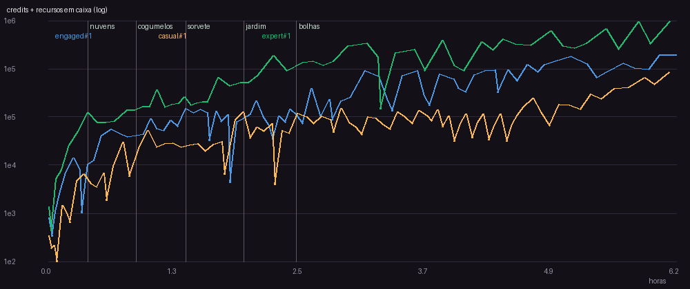
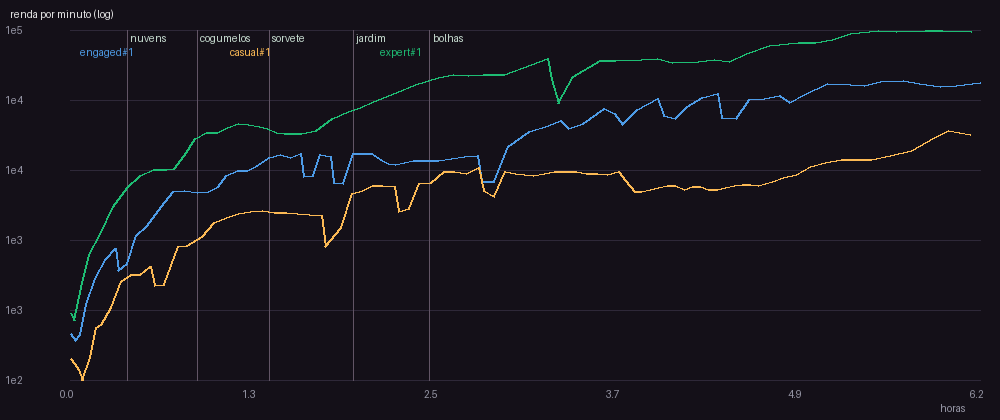
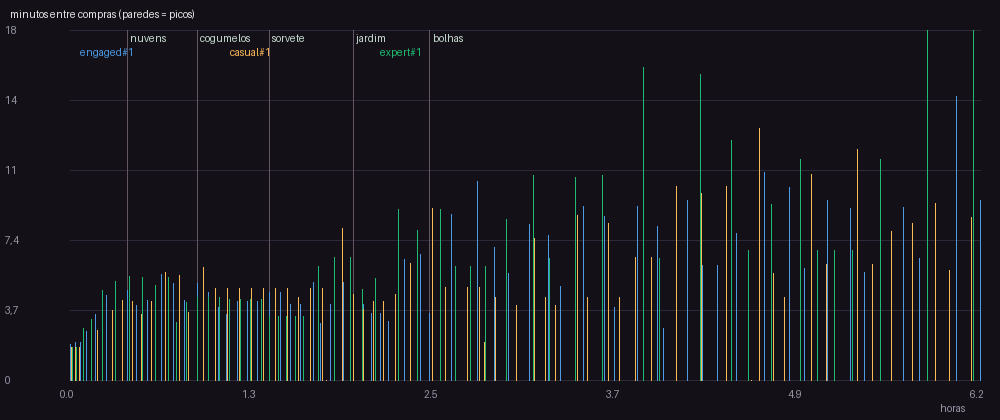
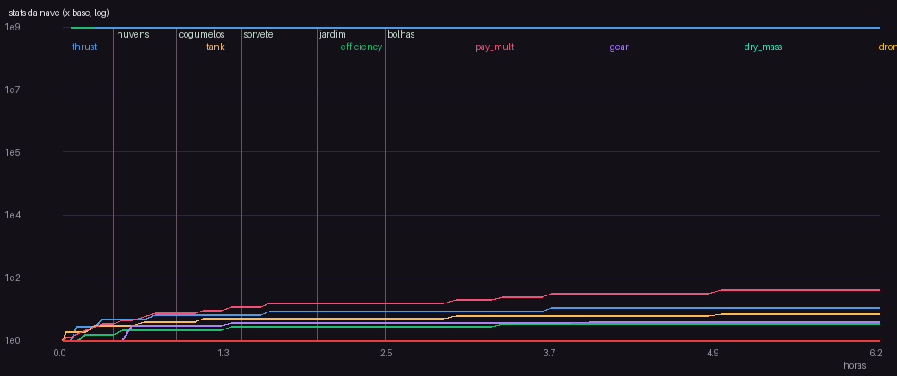

# v21 — pista Mais longe

Versao da spec: 21

## Perfil engaged (seed 1)

- Horas simuladas: 6.15 | runs: 79 | objetivo final: Noneh
- Primeira compra: 114s | intervalo mediano: 5.03 min | p90: 9.22 min
- Run mediano: 251.6s, 10 entregas, batidas 15.2%
- Planetas: {'nuvens': 0.41, 'cogumelos': 0.88, 'sorvete': 1.37, 'jardim': 1.94, 'bolhas': 2.45}
- Prestigios: []
- Niveis comprados por upgrade (%): {'tank': 31.2, 'thrust': 28.6, 'efficiency': 24.5, 'gear': 15.6}
- Gasto por upgrade (%): {'efficiency': 34.8, 'tank': 30.4, 'thrust': 29.1, 'gear': 5.7}
- Maior numero: 340K -> float64 ok
- **Avisos:**
  - 3 paredes (intervalo acima do limite da fase); pior: 5.6 min antes de 'gear' em 0.64h (limite 5 min)
  - upgrades nunca comprados (inuteis ou caros demais?): ['fleet', 'autopilot', 'stabilizer', 'turbo', 'nav_color', 'nav_trail', 'nav_route', 'land_shadow', 'land_level', 'land_predict', 'gas_need']
  - run mediano de 251.6s (alvo 45-240s)

## Perfil casual (seed 1)

- Horas simuladas: 6.09 | runs: 86 | objetivo final: Noneh
- Primeira compra: 104s | intervalo mediano: 4.87 min | p90: 9.1 min
- Run mediano: 249.3s, 8.0 entregas, batidas 9.3%
- Planetas: {'nuvens': 0.82, 'cogumelos': 1.75, 'sorvete': 2.7, 'jardim': 3.65, 'bolhas': 4.61}
- Prestigios: []
- Niveis comprados por upgrade (%): {'tank': 30.6, 'thrust': 28.2, 'efficiency': 23.5, 'gear': 17.6}
- Gasto por upgrade (%): {'thrust': 28.2, 'efficiency': 28.2, 'tank': 27.0, 'gear': 16.5}
- Maior numero: 180K -> float64 ok
- **Avisos:**
  - 3 paredes (intervalo acima do limite da fase); pior: 6.0 min antes de 'gear' em 0.92h (limite 5 min)
  - upgrades nunca comprados (inuteis ou caros demais?): ['fleet', 'autopilot', 'stabilizer', 'turbo', 'nav_color', 'nav_trail', 'nav_route', 'land_shadow', 'land_level', 'land_predict', 'gas_need']
  - run mediano de 249.3s (alvo 45-240s)

## Perfil expert (seed 1)

- Horas simuladas: 6.09 | runs: 60 | objetivo final: Noneh
- Primeira compra: 105s | intervalo mediano: 6.05 min | p90: 11.69 min
- Run mediano: 353.8s, 16.5 entregas, batidas 5.0%
- Planetas: {'nuvens': 0.24, 'cogumelos': 0.59, 'sorvete': 0.95, 'jardim': 1.23, 'bolhas': 1.53}
- Prestigios: []
- Niveis comprados por upgrade (%): {'tank': 32.4, 'thrust': 29.0, 'efficiency': 24.3, 'gear': 14.3}
- Gasto por upgrade (%): {'tank': 39.5, 'thrust': 29.6, 'efficiency': 28.6, 'gear': 2.3}
- Maior numero: 1,22M -> float64 ok
- **Avisos:**
  - 5 paredes (intervalo acima do limite da fase); pior: 5.5 min antes de 'thrust' em 0.42h (limite 5 min)
  - upgrades nunca comprados (inuteis ou caros demais?): ['fleet', 'autopilot', 'stabilizer', 'turbo', 'nav_color', 'nav_trail', 'nav_route', 'land_shadow', 'land_level', 'land_predict', 'gas_need']
  - run mediano de 353.8s (alvo 45-240s)

## Curvas dos upgrades

### Motor

| nivel | custo credits | thrust |
|---|---|---|
| 0 | 40 | 4 |
| 5 | 87 | 4 |
| 10 | 192 | 10 |
| 15 | 421 | 10 |
| 20 | 924 | 16 |
| 25 | 2,03K | 16 |
| 30 | 4,44K | 22 |

### Gasolina

| nivel | custo credits | tank |
|---|---|---|
| 0 | 30 | 100 |
| 5 | 63 | 100 |
| 10 | 132 | 180 |
| 15 | 277 | 180 |
| 20 | 583 | 260 |
| 25 | 1,23K | 260 |
| 30 | 2,58K | 340 |

### Eficiência

| nivel | custo credits | efficiency |
|---|---|---|
| 0 | 60 | 3 |
| 5 | 149 | 3 |
| 10 | 371 | 4.5 |
| 15 | 924 | 4.5 |
| 20 | 2,30K | 6 |
| 25 | 5,72K | 6 |
| 30 | 14,2K | 7.5 |

### Resistência

| nivel | custo credits | gear |
|---|---|---|
| 0 | 80 | 1 |
| 5 | 244 | 1 |
| 10 | 745 | 2.67 |
| 15 | 2,27K | 2.67 |
| 20 | 6,94K | 3.14 |
| 25 | 21,2K | 3.14 |
| 30 | 64,6K | 3.37 |

### Frota

| nivel | custo credits | drones |
|---|---|---|
| 0 | 8,00M | 0 |
| 5 | 83,9M | 5 |
| 10 | 880M | 10 |

### Piloto automático

| nivel | custo credits | autopilot |
|---|---|---|
| 0 | 16,0M | 0.08 |
| 5 | 227M | 0.121 |
| 10 | 3,23B | 0.136 |
| 15 | 45,8B | 0.144 |

### Estabilizador

| nivel | custo credits | stabilizer |
|---|---|---|
| 0 | 250 | 0 |

### Turbo

| nivel | custo credits | turbo |
|---|---|---|
| 0 | 1,50K | 0 |

### Setinha colorida

| nivel | custo credits | nav_color |
|---|---|---|
| 0 | 80 | 0 |

### Rastro

| nivel | custo credits | nav_trail |
|---|---|---|
| 0 | 800 | 0 |

### Rota completa

| nivel | custo credits | nav_route |
|---|---|---|
| 0 | 8,00K | 0 |

### Sombra

| nivel | custo credits | land_shadow |
|---|---|---|
| 0 | 150 | 0 |

### Nivelador

| nivel | custo credits | land_level |
|---|---|---|
| 0 | 500 | 0 |

### Onde vou cair

| nivel | custo credits | land_predict |
|---|---|---|
| 0 | 5,00K | 0 |

### Dá pra chegar?

| nivel | custo credits | gas_need |
|---|---|---|
| 0 | 2,00K | 0 |
